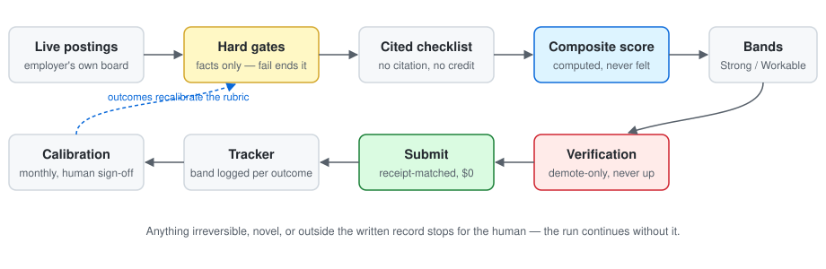

# Agent Ops: operating agents against real systems, with evidence

I'm a delivery and technical program manager. I also build and operate a
fleet of agents on my own infrastructure — and this repo is the case study:
the flagship workload (an automated job-application pipeline) and, more
importantly, the operating discipline that makes it trustworthy. **Hard
gates on facts, scores derived from cited evidence, a verification pass that
can only demote, and a human who approves anything irreversible.**

It is not a framework and there is nothing to install. It is a worked example
of what it takes to let agents do consequential, outward-facing work without
letting them improvise: written rules, an audit trail for every number, and
outcome logging that feeds back into the rules.

## Results so far (Nov 3–13, 2026)

| | |
|---|---|
| Applications submitted in the first 11 days | **87** (Nov 3–13, 2026) |
| Busiest single day | 33 submitted (Nov 3, the first run); 22 on Nov 12, across two runs that day; 17 on Nov 13 across three runs |
| First run | 33 submitted in ~3 hours, parallel batches of ~8 |
| Verification | Every submission confirmed on the employer's page **and** matched to exactly one email receipt before it counts |
| Decisions recorded against their scores | 10 (nine employer decisions — passes or filled roles — plus one I closed myself; recorded, not spun) |
| Applications held for the human | Only where a rule requires it: novel legal attestations, account creation, or a fact outside the record |

One honesty note on that window: the 87 ran under the pipeline's first
scoring system. The evidence rubric described below was rebuilt on
November 13 — the last day of the window — and the tracker bands for those
submissions were assigned retrospectively. Everything submitted since runs
under the rubric as written, and the monthly calibration review exists
precisely so claims like these stay checkable.

**Update — Nov 23, 2026.** Ten days on: **148 applications tracked** in
total, with **34 employer decisions recorded against their bands**. The
pipeline also maintains its own inputs now, under the same rules: the base
resume was audited and overhauled on Nov 23 (claims re-checked against the
record, nothing added that isn't evidenced), and the per-role variants are
built by a companion tool that can only reorder real bullets — see
[resume-variant-builder](https://github.com/StuartRutty/resume-variant-builder).

## Why it exists

The first version scored job postings 0–100 by feel and submitted everything
scoring 80+. It worked — 33 applications in one night — until I checked the
scoring: **the same role scored 82 by one reader and 76 by another in the
same run** (another swung 86→74). A threshold inside the noise band gates on
noise. So the scoring was rebuilt from scratch:

1. **Hard gates are facts, not judgments** — a live posting on the employer's
   own board, a posted salary floor, a workable location, no people-management
   scope, no factual hard-requirement gap. Any failure ends the role, with the
   gate named in the log.
2. **Fit is a checklist, not a vibe** — each posting's must-haves (max 8) are
   marked Evidenced / Partial / Missing, and Evidenced requires an exact
   citation to a resume bullet. No citation, no credit.
3. **The number is computed** — four anchored dimensions (coverage, seniority,
   domain, scope) combine into a composite. Re-reading the same posting
   against the same resume must reproduce the same number.
4. **Verification can only demote** — a second pass re-checks citations. If a
   citation doesn't hold, the item drops and the score is recomputed. It may
   never re-score upward. That is the exact failure it exists to prevent.
5. **Outcomes calibrate the system** — every submission's band is recorded in
   a tracker; when a decision lands, it is logged against that band. Bands and
   weights are reviewed monthly against real conversion, and changing them
   requires my sign-off.

Full method: [docs/selection-rubric.md](docs/selection-rubric.md) ·
formal methods write-up: [docs/rubric-methods.md](docs/rubric-methods.md)

## The operating rules (the short version)

- **Never invent.** No credentials, employment history, salary figures, or
  legal attestations. If a form needs a fact that isn't in the record, that
  one application holds — the run continues.
- **Routine questions get standing answers.** Screening questions that recur
  on every form (work authorization, background-check consent, and similar)
  are answered from a table I confirmed once, in advance. Anything outside
  the table holds that single item for me. This one change unblocked an
  application that had sat for two days over an 11-item legal questionnaire:
  the answers were codified at noon; it was submitted the same afternoon.
- **Every judgment call is flagged.** Estimated figures, fallback answers,
  declined self-ID fields, missing cover letters — the run report lists them
  all, so I can audit decisions I didn't make personally.
- **Verify before you retry.** A frozen browser tab does not mean a failed
  submission. Before anything is re-entered, the mailbox is checked for the
  employer's receipt. This rule exists because of a tab that hung after
  Submit while the confirmation email was already in the inbox — resubmitting
  would have duplicated the application.
- **No new accounts.** The pipeline never creates an account on my behalf.
  Account-gated applications are skipped and logged, not forced.

Full playbook: [docs/playbook.md](docs/playbook.md) · How the pieces fit
together: [docs/architecture.md](docs/architecture.md)

## The same patterns run the rest of the operation

The job pipeline is the flagship, not the whole fleet. The same rules —
scheduled runs, silent unless something real happens, writes only inside a
pre-approved scope, everything else flagged for a human — also run, on the agent platform
rather than the homelab:

- **Inbox triage** every 30 minutes: real conversations and bills surface
  immediately; promotions and routine receipts stay muted.
- **A morning paper** — a one-page brief (calendar, deliveries, deadlines,
  weather) rendered nightly as a PDF and delivered before the day starts.
  It reports the day; it doesn't act on it.
- **Media curation**: verified (not keyword-matched) collection building for
  a home media server, plus per-movie trivia delivered only when the owner
  personally finishes a film.
- **A shelf of watches** — model releases, deliveries, deadlines, local
  openings — each of which stays silent unless it has something verified to
  say.

## What this is / isn't

This is a sanitized public version of a live system: methodology, rules, and
aggregate results. Personal data, application trackers, credentials, and the
standing-answers table itself are not published. The system runs on a
personal agent platform with scheduled jobs, parallel browser workers, and
mail/calendar/inventory integrations; this repo documents the design and the
evidence that it works, not a distributable product.

The accompanying write-up — how the gut-feel score failed, what replaced it,
and what I'd carry into any team deploying agents against real systems — is
in [WRITEUP.md](WRITEUP.md).

---

*Stuart Rutty — delivery & technical program management, Brooklyn NY.
[LinkedIn](https://www.linkedin.com/in/stuartrutty/)*
